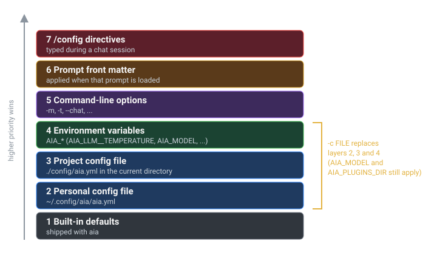

# Configuration Precedence

A setting can come from several places at once. This page shows the order aia applies them in, so you can predict which value wins and track down a surprise.

## The layers

aia starts from its built-in defaults and applies each layer on top of the last. A later layer overrides only the keys it sets; everything else passes through.



| # | Layer | Where it comes from |
|---|---|---|
| 1 | Built-in defaults | Shipped with aia. Listed in [Configuration Keys](../reference/config-keys.md). |
| 2 | Personal config file | `~/.config/aia/aia.yml` (or `$XDG_CONFIG_HOME/aia/aia.yml`). See [The Config File](config-file.md). |
| 3 | Project config file | `./config/aia.yml` in the directory you run aia from. |
| 4 | Environment variables | `AIA_*`, such as `AIA_LLM__TEMPERATURE`, plus `AIA_MODEL` and `AIA_PLUGINS_DIR`. See [Environment Variables](environment.md). |
| 5 | Command-line options | `-m`, `-t`, `--chat` … See [Command-Line Options](../reference/cli.md). |
| 6 | Prompt front matter | The YAML at the top of a prompt file, applied when that prompt is loaded. See [Prompt Files](../prompts/prompt-files.md). |
| 7 | `/config` and friends | Directives you type during a chat: `/config`, `/model`, `/temperature`, `/top_p`. |

## A worked example

Suppose every layer has an opinion about the temperature:

```yaml
# ~/.config/aia/aia.yml                 (layer 2)
llm:
  temperature: 0.7
```

```yaml
# ~/work/api/config/aia.yml             (layer 3)
llm:
  temperature: 0.4
```

```markdown
<!-- ~/.prompts/extract_dates.md        (layer 6) -->
---
temperature: 0.0
---
List every date mentioned in the text, one per line, in ISO 8601.
```

| You run (from `~/work/api`) | Temperature used | Why |
|---|---|---|
| `aia --chat` | `0.4` | The project file overrides your personal file. |
| `AIA_LLM__TEMPERATURE=0.9 aia --chat` | `0.9`* | The environment overrides both files. |
| `aia -t 0.2 --chat` | `0.2` | The command line overrides the environment. |

\* aia converts the text `0.9` to a number; see [Environment Variables](environment.md). The order is the same for every key.

If you then run `aia -t 0.2 extract_dates contract.txt`, the prompt's `temperature: 0.0` replaces `0.2` when the prompt is loaded, so that prompt runs at `0.0`.

Check any combination without calling a model by adding `--dump`:

```console
$ cd ~/work/api && aia -t 0.2 --dump /tmp/c.yml && grep temperature /tmp/c.yml
Config successfully dumped to /tmp/c.yml
  :temperature: 0.2
```

`--dump` shows layers 1–5. Front matter and directives are applied later, while aia runs.

## When layers 6 and 7 take effect

aia builds the model connection (the *robot*) once, at startup, from layers 1–5. Front matter and directives are applied later, while aia runs, and they update the configuration from that point on:

- **Model settings apply before the next prompt or chat turn.** `temperature:`, `top_p:` and `config: llm:` in a prompt's front matter, and `/temperature`, `/top_p` or `/config llm.…` in chat, retune the running robot (and every crewmate) in place, so the conversation is kept.
- **A different model rebuilds the robot.** A front-matter `model:` switches models before that prompt runs, the same way `/model` does in chat, and carries the conversation over as `model_switch_history` says (see [Chat Sessions](../everyday/chat.md#switching-models-mid-conversation)).
- **Other settings apply right away** — for example the output file, the pipeline (`next:` / `pipeline:`), or flags such as `tokens`.

### Front matter lasts for the rest of the run

When aia loads a prompt, its front matter changes the running configuration and the change stays in place. In a pipeline, a setting made by the first prompt is still in effect for the second prompt unless that prompt sets its own.

## `-c` replaces layers 2–4

`-c FILE` (`--config-file`) swaps in a different configuration instead of adding another layer. With it, aia applies:

1. Built-in defaults
2. `FILE`
3. `AIA_MODEL` and `AIA_PLUGINS_DIR`, if set
4. Command-line options
5. Front matter and directives, as usual

Your personal config file, any `./config/aia.yml`, and all other `AIA_*` variables are ignored for that run. Use it to keep self-contained setups — "local models only", "work account" — that your everyday settings can't leak into.

## Lists are replaced, not merged

When a higher layer sets a list — `models`, `pipeline`, `tools.paths`, `mcp_servers` — it replaces the lower layer's list. `-m gpt-4o` on the command line means *only* `gpt-4o`, even if your config file lists three models.

Some command-line options add to what came before them on the same command line: `-m`, `-s`, `-n`, `-p`, `--rq`, `--at`, `--rt`, `--mu`, `--ms` and `--mcp` can be repeated. `--mcp FILE` adds its servers to the `mcp_servers` from your config file.

## Troubleshooting a setting

1. Run `aia --dump /tmp/c.yml` with the same options and from the same directory. If the value is wrong there, it comes from layers 1–5.
2. Run `env | grep '^AIA_'` to spot a forgotten `export`.
3. Look for `config/aia.yml` in the current directory.
4. If `--dump` looks right but the run doesn't, check the prompt's front matter: it is applied after `--dump` reads the configuration.
5. In chat, `/config` shows the live values.

## See also

- [The Config File](config-file.md)
- [Environment Variables](environment.md)
- [Configuration Keys](../reference/config-keys.md)
- [Prompt Files](../prompts/prompt-files.md)
