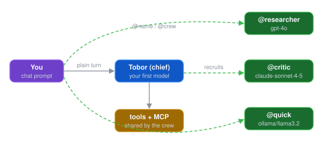

# Crews

Every AIA chat is backed by a **crew**: a small team of robots that share the conversation. With a single model, the crew has one member. You can recruit more members in the middle of a chat, address each one by name, and have them build on each other's answers.

## The chief and its crewmates

- The **chief** is the robot you started with. With one model it's named **Tobor**. It answers your normal messages, and it's the robot that `/spawn` builds specialists from.
- **Crewmates** (recruits) are robots you add during the chat. Each has a name, a model and its own instructions, and answers to `@name`.

If you start with several models (`aia --chat -m gpt-4o-mini,claude-haiku-4-5`), each model is a crew member. The first one is still Tobor and is the chief, and the others are named after their model family (Zen, Spark, ...). Your messages then go to all of them; see [Multiple Models](multi-model.md).



Use `/robots` to see the crew, each member's model, and its `@` handle:

```text
> /robots
```

## Addressing crewmates with @mentions

Start a message with `@name` to send it to that crewmate instead of the chief. Names aren't case-sensitive.

```text
> @critic Does this API design have any obvious flaws?
```

Only the named robot replies. AIA removes the leading `@critic` before passing the message on. Unknown names are reported rather than ignored:

```text
Unknown robot: @critc  (available: Tobor, researcher, critic)
```

### Several crewmates at once

*Where* you put the mentions changes how the crewmates run:

- **Mentions only at the start: they run at the same time.** Each replies independently.

    ```text
    > @researcher @critic what are the trade-offs of optimistic locking?
    ```

- **A mention inside the message: they run one after another.** The mentioned crewmates take turns, and each reply is passed to the others before their turn, so later crewmates build on earlier answers.

    ```text
    > draft a plan @researcher then have @critic poke holes in it
    ```

    Here `@researcher` answers first, and `@critic` sees that draft before replying.

### Broadcasting to the whole crew

`@crew` sends the message to every member at once:

```text
> @crew in one sentence, what is your specialty?
```

Because `crew` is reserved for broadcasting, no member can be named `crew`.

!!! tip "Local models and broadcasts"
    Broadcasts and leading mentions send several requests at the same time. If every crewmate uses the same local model server, the requests queue up there and can time out. Raise the server's parallelism (for Ollama, `OLLAMA_NUM_PARALLEL`), give each crewmate a smaller task, or use a mention inside the message so they run one at a time.

## Recruiting crewmates

`/add_recruit` (alias `/add`) adds a crewmate that stays for the rest of the session:

```text
/add_recruit <name> [provider/model] [skill:<id>...] [system prompt...]
```

```text
# Same model as the chief, default instructions
> /add_recruit researcher

# A specific model and instructions
> /add_recruit critic anthropic/claude-sonnet-4-5 You are a ruthless design critic. Find flaws.

# A local model
> /add_recruit quick ollama/llama3.2 You are concise and fast.
```

- **name** is required and must be unique (and not `crew`).
- **provider/model** is optional. Leave it out to use the chief's model. Use `-` or `inherit` as a placeholder when you want the chief's model *and* want to write instructions.
- Everything after the model is the crewmate's **system prompt**. Without one, the crewmate is simply told `You are <name>.`

AIA confirms the recruit:

```text
Recruited 'critic' into the crew (anthropic/claude-sonnet-4-5).
```

Recruits get the chief's tools and share its [MCP server](mcp.md) connections, so they can do the same work as the chief. Tool approvals follow your `--tool-approval` setting.

### Giving a crewmate a role with skills

A crew of identical robots gives you identical answers. Give each crewmate a **skill**, a reusable set of instructions from your skills directory (list them with `/skills`; see [Roles and Skills](../everyday/roles-and-skills.md)):

```text
# A skill as the role
> /add_recruit reviewer skill:security-review

# A skill, a model, and an extra instruction
> /add_recruit reviewer ollama/llama3.2 skill:security-review focus on the auth module

# Several skills (repeat the token or separate with commas)
> /add_recruit reviewer - skill:security-review,ruby-style
```

`skill:<id>` can appear anywhere after the name. The crewmate's instructions are the skills' text followed by any system prompt you add. If a skill can't be found, the recruit fails with a message naming the missing skill, so you never get a crewmate without the role you meant to give it.

This turns `@crew` from four copies of the same answer into real division of labour, for example a security reviewer, a performance reviewer, a test reviewer and a style reviewer.

### Re-skilling a crewmate

`/reskill` gives a crewmate a fresh conversation and new instructions. It keeps its name and model:

```text
> /reskill reviewer skill:test-writing
> /reskill reviewer you now summarize the other members' findings
```

Use it to bring a crewmate that wandered off task back on track, or to move the crew from one phase to the next (review, then fix, then summarize). The chief can't be re-skilled.

### Dropping a crewmate

```text
> /drop_recruit researcher        # alias: /drop
Dropped 'researcher' from the crew.
```

The chief can't be dropped.

## Letting the chief recruit

The chief has two built-in tools for managing the crew: one to **recruit** a robot (name, optional model, optional skills, optional instructions) and one to **reskill** a member. So you can simply ask:

```text
> Put together a review team: one robot for security, one for performance,
  each using the matching skill, then have them review lib/payment.rb.
```

The chief may recruit the members itself. Run `/robots` to see what it created. These tools show up in `/tools` as `RecruitRobotTool` and `ReskillRobotTool`.

## Recruits versus spawned specialists

`/spawn` (see [Advanced Modes](advanced-modes.md#spawn-call-in-a-specialist)) also creates a robot, but for a different purpose:

| | `/add_recruit` | `/spawn` |
|---|---|---|
| Handles | Every message you send it with `@name` | Only your **next** message |
| Joins the crew | Yes: listed in `/robots`, reachable with `@name` | No |
| Good for | A standing teammate | A one-off expert answer |

Both accept the same `name provider/model instructions` form. If you keep spawning the same specialist, recruit it instead.

## See also

- [Multiple Models](multi-model.md)
- [Advanced Modes](advanced-modes.md): `/debate`, `/delegate` and other modes that use the whole crew
- [Chat Sessions](../everyday/chat.md)
- [Directives reference](../reference/directives.md)
