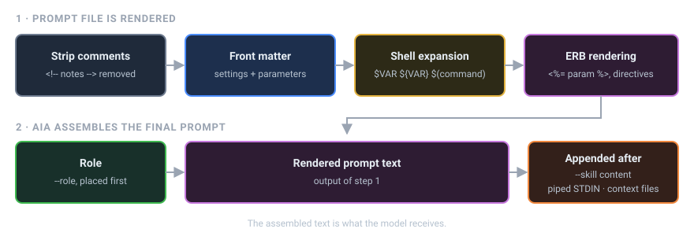

# Prompt Files

A prompt file is a Markdown file that holds a prompt you want to reuse. You keep prompt files in your prompts directory and run one by naming it on the command line.

## Prompt IDs

The **prompt ID** is the file name without its `.md` extension. A file named `~/.prompts/code_review.md` has the prompt ID `code_review`, and you run it like this:

```bash
aia code_review
```

AIA looks for `<prompts dir>/<prompt ID>.md`. If the file is missing, AIA treats the word as a context file name instead, and stops because no such file exists:

```text
The following files do not exist: code_reveiw
```

!!! warning "Use letters, digits and underscores in prompt IDs"
    Name prompt files with letters, digits and underscores only, such as `code_review.md` or `summarize2.md`. In AIA 2.0, IDs that contain a hyphen (`code-review`) or a subdirectory (`dev/review`) are not loaded from the file. The ID itself is sent to the model as the prompt text. Rename those files with underscores and keep them at the top level of the prompts directory.

If the first argument names a file that exists in your current directory, AIA treats it as a context file rather than a prompt ID. Context files alone aren't enough to run: unless you add `--chat` (or the file is an [executable prompt](executable-prompts.md)), AIA stops with `A prompt ID is required…`. See [Context Files & Piping](../everyday/context-and-piping.md).

## The prompts directory

The default prompts directory is `~/.prompts`. You can change it three ways. They are listed here from lowest to highest priority:

=== "Config file"

    ```yaml
    # ~/.config/aia/aia.yml
    prompts:
      dir: ~/work/prompts
    ```

=== "Environment variable"

    ```bash
    export AIA_PROMPTS__DIR=~/work/prompts
    ```

=== "Command line"

    ```bash
    aia --prompts-dir ~/work/prompts code_review
    ```

A typical layout looks like this:

```text
~/.prompts/
├── code_review.md        # prompt IDs live at the top level
├── summarize.md
├── standup.md
├── roles/                # roles, used with --role
│   ├── ruby_expert.md
│   └── editor.md
├── skills/               # skills, used with --skill (one directory per skill)
│   └── changelog/
│       └── SKILL.md
├── tools/                # default directory for your own tools
└── _prompts.log          # AIA's prompt history log
```

Roles and skills are covered in [Roles & Skills](../everyday/roles-and-skills.md). Tools are covered in [Tools](../extending/tools.md).

## Anatomy of a prompt file

A prompt file has two parts. The first is an optional YAML **front matter** block between `---` lines. The second is the **body**, the text that becomes the prompt.

```markdown
---
parameters:
  language: Ruby
  focus: readability
---
<!-- Reviewer notes: keep this prompt short. HTML comments are removed. -->
You are reviewing <%= language %> code.
Concentrate on <%= focus %> and point out anything that will surprise
the next person who reads it.

Today is $(date +%A).
```

When you run it, AIA does the following:

1. Removes HTML comments (`<!-- ... -->`), so you can leave notes for yourself in the file.
2. Reads the front matter and applies its settings.
3. Expands shell references such as `$(date +%A)` and `$HOME`.
4. Renders ERB tags such as `<%= language %>`, and asks you for any required parameter values first.
5. Adds the role in front, then adds skills, piped input and context files after the text. (In a chat session, skills go into the system prompt instead.)



Steps 3 and 4 are explained in [ERB & Shell](erb-and-shell.md). Parameters are explained in [Parameters](parameters.md).

## Front matter keys

AIA understands these keys at the top level of the front matter:

| Key | What it does | Example |
|-----|--------------|---------|
| `parameters` | Declares the values the prompt needs. A `null` (empty) value means required. | `parameters: { name: null, tone: friendly }` |
| `next` | Prompt ID to run after this one | `next: explain_joke` |
| `pipeline` | List of prompt IDs to run after this one | `pipeline: [evaluate, pick_best]` |
| `shell` | `false` turns off shell expansion for this file | `shell: false` |
| `erb` | `false` turns off ERB rendering for this file | `erb: false` |
| `config` | Any other AIA setting, nested the same way as in the config file | see below |

`next` and `pipeline` cannot both appear in one file. AIA stops with an error if they do.

Model settings (`model`, `temperature`, `top_p`, and `llm:` keys under `config:`) take effect before the prompt is sent. A different `model:` rebuilds the robot, carrying the conversation over as `model_switch_history` says; the other settings retune it in place. See [Configuration Precedence](../configuration/precedence.md#when-layers-6-and-7-take-effect).

### The `config:` section

Use `config:` for any setting that has no shortcut key. It takes the same nested keys as `~/.config/aia/aia.yml` (see [Config Keys](../reference/config-keys.md)):

```yaml
---
config:
  flags:
    tokens: true
---
Summarize the attached file in five bullet points.
```

Don't set a value both ways. If a top-level key such as `temperature:` and the matching `config:` key are both in one file, AIA stops with a `Conflict:` error that names both keys.

### Other keys

AIA ignores any front matter key it doesn't recognize. That makes the front matter a good place for your own notes:

```yaml
---
description: Weekly status report for the platform team
author: dewayne
---
```

!!! note "Front matter settings are scoped to the run"
    Settings from front matter change AIA's configuration for the rest of the current run. They never change your config file.

## Finding prompts with fzf

Once you have a lot of prompts, you may not remember their exact names. Install [fzf](https://github.com/junegunn/fzf) and use `--fuzzy` (`-f`) to choose a prompt interactively:

```bash
brew install fzf      # macOS
aia --fuzzy
```

fzf lists every prompt ID at the top level of your prompts directory and shows a preview of the highlighted file. Type to filter the list, press ++enter++ to run the selected prompt, or press ++esc++ to cancel.

`--fuzzy` works with other options too:

```bash
aia -f --model gpt-4o          # pick a prompt, run it with gpt-4o
aia -f --chat                  # pick a prompt, then keep chatting
```

If fzf isn't installed, `aia --fuzzy` stops with `Error: 'fzf' is not installed. Please install 'fzf' to use the --fuzzy option.`

## Writing a prompt step by step

1. Create the file:

    ```bash
    mkdir -p ~/.prompts
    cat > ~/.prompts/commit_message.md <<'EOF'
    Write a conventional commit message for the following staged diff.
    Use a subject line under 60 characters, then a short body.

    $(git diff --cached)
    EOF
    ```

2. Run it from inside a git repository with staged changes:

    ```bash
    aia --no-output commit_message
    ```

3. Improve the wording and run it again. The prompt is plain text, so you can refine it as often as you like.

## See also

- [Parameters](parameters.md): make one prompt work for many inputs
- [Directives](directives.md): include files, web pages and other prompts
- [ERB & Shell](erb-and-shell.md): dynamic content in a prompt
- [Pipelines](pipelines.md): chain prompts together with `next` and `pipeline`
- [Running Prompts](../everyday/running-prompts.md): everyday command-line use
